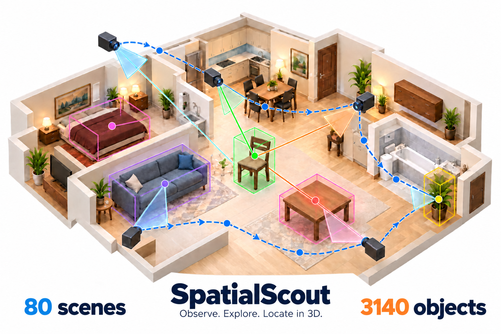
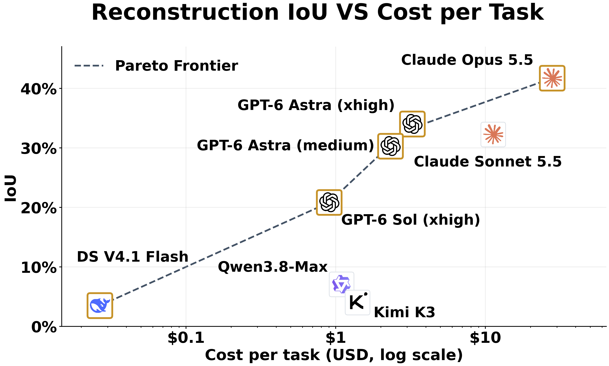
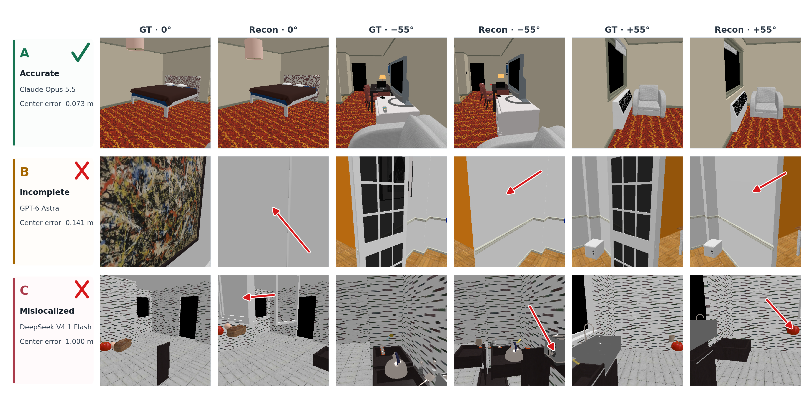

# SpatialScout

[](https://huggingface.co/datasets/jessezhaoxizhang/SpatialScout)
[](https://github.com/JesseZZZZZ/SpatialScout)

Camera-based, interactive 3D object localization with vision-language models.
This repository contains the code to **rerun the evaluation with your own model
API**. Scene meshes, textures, robot resources and reference annotations are
available on [Hugging Face](https://huggingface.co/datasets/jessezhaoxizhang/SpatialScout).
Raw predictions, trajectories and prior experiment outputs are not distributed.
The figures below illustrate the benchmark and its reported results.


## Benchmark overview



## Reconstruction quality and cost



## Qualitative reconstruction examples



## 1. Benchmark protocol

The main evaluation is `prepared_80`: **80 scenes and 3,140 target instances**.
It combines `additional_50` and `procthor_30`. Scene sources are iTHOR (24),
RoboTHOR (12), ArchitecTHOR (8), ReplicaCAD (6), and ProcTHOR (30).
`configs/scene_catalog.json` also retains the original 10 development scenes; `--batch all`
would evaluate 90 scenes and is **not** the main 80-task protocol.

- The model gets an entity library without object coordinates, an initial image,
  camera tools, a triangulation tool, and submission/termination tools.
- Predict each target's geometric center in meters, in the **initial camera
  frame**: +x forward, +y left, +z up. IDs in an equivalence group are
  interchangeable for scoring. The architectural stage and robot are excluded.
- A turn is a model response, which can contain multiple tool calls. Main runs
  use **100 model turns**, simulation seed 0, 512×512 captures, and the per-scene camera starts and
  target counts in the catalog. Parallelism changes scheduling, not turn budget.
- Choose the exact model version, provider and reasoning effort explicitly.
  Responses is the original OpenAI default; Chat Completions is available for
  compatible endpoints. Anthropic and Gemini use their native adapters.
- A valid scored trajectory ends with an executed `finish_mapping` whose result
  has `finished=true`. Recoverable intermediate tool errors are allowed. A
  turn-limit exit with predictions but no successful finish is excluded.
- Original model IDs, reasoning settings and native adapters: `configs/model_settings.json`.
  These are recorded protocol settings, not model scores. In particular, the original
  DeepSeek and Qwen runs used the Anthropic adapter through their API provider;
  do not infer an adapter solely from the model company name.
- Task prompt and effective tool definitions: `docs/task_prompt.txt` and
  `docs/tool_definitions.json`. Runtime source of truth: `spatialscout/benchmark/room.py`.

## 2. System requirements

**Linux x86_64 and Python 3.10**. Rendering and physics run on CPU; a GPU and a
windowing desktop are not required. Use Ubuntu/Debian or the supplied Docker
image. Begin with one concurrent scene; increase parallelism only when host RAM
and CPU permit it. Installation downloads Python wheels and requires internet.
Model evaluation also needs your own vision/tool-capable API service.

The renderer is pinned to **SAPIEN 3.0.0b1**, **NumPy 1.26.4**, and the vendored
ManiSkill3 snapshot (`3e948a52219f663456b74b500e25b5407a04a86a` plus local changes).
The installer uses **PyTorch 2.5.1+cpu** and Mesa lavapipe Vulkan.
`requirements/render-cpu.txt` pins the Python dependencies.
`requirements/frozen.txt` is a reference snapshot of the original host (including
CUDA packages); use the CPU installer below for a new machine.

## 3. Download and attach the dataset

Place the supplied Hugging Face dataset directory anywhere outside the code
repository. Its root must contain `assets/`, `runtime/`, `benchmark/` and
`MANIFEST.json`. Set its absolute path:

```bash
export SPATIALSCOUT_DATA=/absolute/path/to/SpatialScout
python3 scripts/attach_data.py "$SPATIALSCOUT_DATA"
# Optional: add --verify to compare every file against its SHA-256 manifest.
```

This creates `assets/`, `benchmark_data`, and links for the simulator's binary
resources. Keep the dataset directory available. Nothing is copied into Git and
no historical `outputs/` directory is needed.

After the dataset is published, you may download it with `snapshot_download`:

```python
from huggingface_hub import snapshot_download
snapshot_download(repo_id="jessezhaoxizhang/SpatialScout", repo_type="dataset",
                  local_dir="/absolute/path/to/SpatialScout")
```

Dataset repository: [jessezhaoxizhang/SpatialScout](https://huggingface.co/datasets/jessezhaoxizhang/SpatialScout).
Code repository: [JesseZZZZZ/SpatialScout](https://github.com/JesseZZZZZ/SpatialScout).
The dataset can also be attached directly from the accompanying local release folder.

## 4. Install the environment (native Linux)

On Ubuntu 22.04, install Python 3.10 and venv support first:

```bash
sudo apt-get update
sudo apt-get install -y python3.10 python3.10-venv
```

On distributions without these packages, use the Docker alternative below or
provide an existing Python 3.10 executable via `RENDER_PYTHON`.
Run from this repository root:

```bash
RENDER_PYTHON=python3.10 bash setup_render_environment.sh
```

The installer installs the Mesa/Vulkan/EGL system libraries (via apt/sudo),
creates `.venv`, installs pinned Python dependencies, the local ManiSkill3
package and this SpatialScout package in editable mode, and applies `spatialscout/tools/patch_sapien_cpu.py`. The patch is specific to this pinned
SAPIEN binary and CPU rendering. Do not apply it to a GPU Vulkan/CUDA environment.
If the system libraries have already been installed by an administrator:

```bash
SKIP_SYSTEM_PACKAGES=1 RENDER_PYTHON=python3.10 bash setup_render_environment.sh
```

Always launch simulation through `bash render_env.sh ...`: it discovers the Mesa
ICD filename on the new machine and sets the asset path and EGL configuration.
Activating the venv alone does not set these rendering variables.

Prepare a scene without contacting any model API:

```bash
bash render_env.sh -m spatialscout.benchmark.room --mode prepare \
  --catalog-scene ithor_kitchen_13 --output-dir outputs/prepare_demo
```

To regenerate the fixed task annotations locally (optional; run evaluation itself
creates annotations in each task's output directory):

```bash
bash render_env.sh -m spatialscout.data.prepare --batch additional_50 --parallelism 1
bash render_env.sh -m spatialscout.data.prepare --batch procthor_30 --parallelism 1
bash render_env.sh -m spatialscout.data.index
```

## 5. Run your model on all 80 tasks

Set your own endpoint, key and exact model ID. No credentials are bundled.

```bash
export VLM_BASE_URL='https://YOUR_API_HOST/v1'
export VLM_API_KEY='YOUR_OWN_KEY'
export VLM_MODEL='EXACT_MODEL_ID'
export VLM_API_BACKEND=openai
export VLM_API_MODE=responses       # or chat for Chat Completions endpoints
export REASONING_EFFORT=xhigh
export PARALLELISM=1
export EVAL_OUTPUT_DIR=outputs/room_benchmark/my_model_xhigh
bash scripts/run_evaluation.sh
```

For the medium setting, use `REASONING_EFFORT=medium` and a **new output directory**.
Use `VLM_API_BACKEND=anthropic` or `gemini` for their native endpoints. Gemini
accepts only `low`, `medium`, or `high` reasoning settings. Model/provider aliases
and endpoint support must match the API account being used.

The launcher is equivalent to:

```bash
bash render_env.sh -m spatialscout.benchmark.batch --batch prepared_80 \
  --model "$VLM_MODEL" --api-backend "$VLM_API_BACKEND" \
  --api-mode "$VLM_API_MODE" --reasoning-effort "$REASONING_EFFORT" \
  --max-turns 100 --parallelism 1 --output-root "$EVAL_OUTPUT_DIR"
```

Rerun after an interrupted/API-failed batch, keeping the same model and settings:

```bash
bash scripts/run_evaluation.sh --resume
```

The runner skips previously completed tasks and recreates incomplete task
folders. Its completion rule is a file/process check; the final scorer applies
the stricter successful `finish_mapping` rule. To retry a turn-limit task already
marked complete by the runner, use a new output directory or explicitly rerun
that scene. Preserve the raw output directories for auditing a new evaluation.
Each task writes an entity library, GT, predictions, trajectory, token usage,
metrics and rendered images. None of those model-run artifacts are in this release.

For one task with an API:

```bash
bash render_env.sh -m spatialscout.benchmark.room --mode run \
  --catalog-scene ithor_kitchen_13 --model "$VLM_MODEL" \
  --api-backend "$VLM_API_BACKEND" --api-mode "$VLM_API_MODE" \
  --reasoning-effort "$REASONING_EFFORT" --max-turns 100 \
  --output-dir outputs/single_task
```

## 6. Compute the eight reported metrics

```bash
.venv/bin/python -m spatialscout.evaluation.score "$EVAL_OUTPUT_DIR"
```

This produces `eight_metrics.json` and `eight_metrics.csv` in your run directory.
Both macro and micro scores are provided, as fractions in saved files and
percentages on stdout. **Macro (average of per-task metrics)** is the primary
aggregation. Its denominator is the number of eligible finished tasks; report
that count along with every model's results. Micro pools target instances across
tasks. Do not mix these two aggregation methods in a comparison.

| Evaluated objects | Metric 1 | Metric 2 | Metric 3 | Metric 4 |
| --- | --- | --- | --- | --- |
| All GT objects | Mean IoU | Fraction IoU > 0% | Fraction IoU > 50% | Fraction IoU > 90% |
| Submitted objects | Mean IoU | Fraction IoU > 0% | Fraction IoU > 50% | Fraction IoU > 90% |

Unsubmitted targets contribute zero in the all-GT metrics. Submitted-only metrics
use the number of submitted objects; a task with zero submissions is assigned
zero for those metrics. Thresholds are **strictly greater than**. Predictions
supply centers, not shapes: each original world-axis-aligned render-geometry box
is translated to its submitted center. Same-equivalence-group one-to-one matching
maximizes total IoU for mean IoU; threshold hits are matched separately. See
`spatialscout/evaluation/iou.py`. The generic scorer does not require the simulator or API;
`requirements/evaluation.txt` is sufficient for scoring existing new results.

## 7. Docker alternative

```bash
docker build -f Dockerfile.render -t spatialscout-cpu .
mkdir -p outputs
docker run --rm --shm-size=2g \
  -v "$SPATIALSCOUT_DATA:/data:ro" -v "$PWD/outputs:/workspace/outputs" \
  spatialscout-cpu -m spatialscout.benchmark.room --mode prepare \
  --catalog-scene ithor_kitchen_13 --output-dir outputs/prepare_demo
```

The entry point attaches `/data` automatically inside the container. To evaluate
all 80 scenes with environment variables already exported on the host:

```bash
docker run --rm --shm-size=2g \
  -v "$SPATIALSCOUT_DATA:/data:ro" -v "$PWD/outputs:/workspace/outputs" \
  -e VLM_BASE_URL -e VLM_API_KEY -e VLM_MODEL \
  spatialscout-cpu -m spatialscout.benchmark.batch --batch prepared_80 \
  --model "$VLM_MODEL" --api-backend openai --api-mode responses \
  --reasoning-effort xhigh --max-turns 100 --parallelism 1 \
  --output-root outputs/room_benchmark/my_model_xhigh
```

Select the appropriate adapter/mode for your provider as in the native command.
To score inside the same image, pass `-m spatialscout.evaluation.score` followed
by the mounted run directory as the container arguments. Docker uses the same CPU software renderer.

## 8. Source layout and reproduction limits

```text
SpatialScout/
├── spatialscout/             # Python package
│   ├── agent/               # Camera/API adapters and token accounting
│   ├── benchmark/           # Scene task and batch evaluation
│   ├── evaluation/          # IoU matching and eight-metric scoring
│   ├── data/                # Download, prepare, index, camera selection
│   ├── tools/               # Capture and SAPIEN environment patch
│   └── paths.py             # Shared repository/configuration paths
├── scripts/                 # Launch, dataset attachment and upload helpers
├── configs/                 # Fixed scene catalog and model settings
├── requirements/            # Pinned environment and scoring dependencies
├── ManiSkill3/              # Vendored simulator runtime source
├── docs/                    # Prompts, tool schemas, figures and documentation
├── pyproject.toml           # Editable Python package installation
├── setup_render_environment.sh
├── render_env.sh
└── Dockerfile.render
```

Run package entry points from the repository root using `python -m`.
For simulation, use `bash render_env.sh -m ...` so the rendering environment
is configured. See [docs/architecture.md](docs/architecture.md) for module roles.


Model APIs are stochastic and can change behind aliases. Reproduce the protocol
with a fixed model ID, provider, effort, turn budget and catalog; exact scores are
not guaranteed. Record these settings and your fresh trajectories. This release
preparation did not run a new model evaluation, rebuild the environment from
scratch, or build the Docker image on another machine.

- `spatialscout/benchmark/room.py`, `spatialscout/agent/harness.py`, `spatialscout/agent/token_usage.py`: task and model tools.
- `configs/scene_catalog.json`: fixed scene and camera configuration.
- `spatialscout/benchmark/batch.py`, `scripts/run_evaluation.sh`: 80-task evaluation.
- `spatialscout/evaluation/iou.py`, `spatialscout/evaluation/score.py`: eight-score evaluation.
- `ManiSkill3/`: vendored simulator source; binary resources live in the dataset.
- `setup_render_environment.sh`, `render_env.sh`, `Dockerfile.render`: environment.
- `docs/release_changes.md`: small portability changes in this release.
- Only evaluation, task preparation, environment and IoU-scoring code is included;
  plotting and historical trajectory-analysis scripts are excluded.

## 9. Publish to GitHub and Hugging Face

```bash
python3 scripts/upload_github.py
python3 scripts/upload_huggingface.py --folder "$SPATIALSCOUT_DATA"
```

Each script prompts for its own platform access token with hidden input. These
are GitHub/Hugging Face credentials, not the model API key used for evaluation.
The GitHub script requires `git`; the HF script installs the official upload
client into a separate cache environment if needed. Detailed permissions and
upload behavior: [docs/publishing.md](docs/publishing.md).

中文速查见 [README_zh.md](README_zh.md)。第三方来源见
[THIRD_PARTY_NOTICES.md](THIRD_PARTY_NOTICES.md)。
